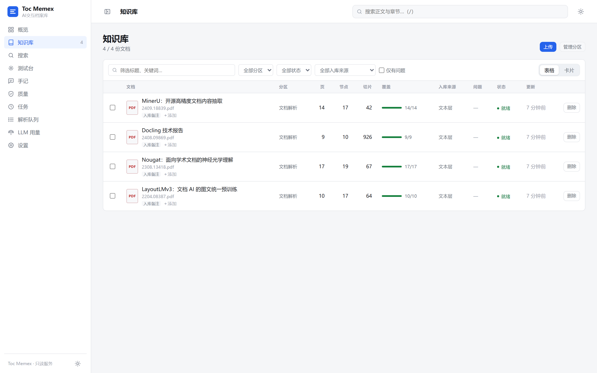

# 🦉 Toc Memex

**给 agent 的本地文档图书馆：目录由它重建，页码它来对齐，引用钉在原文那一页。**

`MIT` · `Python 3.12+` · 本地 SQLite · MCP · 无向量库
[](LICENSE) [](pyproject.toml)


---

## 这一行就懂它

Toc Memex 把一摞本地 PDF / 扫描件 / Word / Markdown 变成一台随时可核对的引擎：重建目录树、把印刷页码对齐到 PDF 物理页、把检索结果钉在具体页面上。agent 通过 MCP 查库，每条结果都带章节路径和 1-based 页码——它报出的引用和 PDF 阅读器显示的完全一致。


## 为什么用它 · Why Toc Memex

普通文档 RAG 给结论，Toc Memex 给「结论 + 出处」。区别在三件事：

- **建目录**：从印刷目录页、PDF 书签、Word 标题、OCR 段落标题还原章节树，把书上印的 `-47-` 对齐到 PDF 的第 53 页；缺失页和重复节点会标出来。
- **检索**：FTS5 BM25 + jieba，章节号直达（`8.3`）、文档号直达（`ACME 100`）、目录标题命中置顶、可配同义词表。
- **记账**：阅读、引用、备注、勘误都绑定到具体页面；跨 agent 的交接条、外部会话都在同一本账上，下一位接手的人或 agent 先看到这里。

核心是通用规则：章节号、文档号、页码映射；论文、财报、国标只是不同的配置。

> **当前适配范围**：面向目录结构完整的规范文档（有书签、印刷目录页、或 Word 标题样式）。无目录结构的二手资料、散页扫描件，是后续适配的重点。

## 围绕「出处」做了一整套治理

引用只解决「能找到」，这本账还解决「能不能信」。质量信号会自动汇总——搜了但零命中的查询、被搜了很多但从来没人标为已用的文档、待人工批准的修正提案、最近被回滚的改动——凝成一个只读快照：

- 修正走**提案**而非直接改：低风险的自动落地，高风险的（改页码、合并/拆分目录节点）等人工批准；
- 每次应用都留快照，可**单步回滚**，备份是事务性的；
- 页面上每一条阅读、每一条勘误都有归属，下一位 agent 不会重蹈覆辙。

## 拿 OCR 当实验对象

同类工具把 OCR 当黑盒，Toc Memex 把它当可对照的实验对象。内置「测试台」：同一份文档 × 不同 OCR（Paddle / Mistral / MinerU / Azure）× 不同 LLM，规则目录和 LLM 目录并排打分，对比跑在隔离目录里、不动正式库。选型有据、有对比记录，而不是凭感觉换 provider。

站在两个开源底座上：

- **OCR** —— [PaddleOCR-VL](https://github.com/PaddlePaddle/PaddleOCR) 提供结构化输出（`parsing_res_list` 的 label / bbox / order），是目录重建与页码对齐的原始依据。
- **LLM 接入** —— [magpie](https://github.com/yetone/magpie) 本地模型网关提供低成本模型调用，Toc Memex 用 `/api/endpoints/magpie/probe` 探测本机默认端口。

## 快速开始 · Quick start

一次安装拿到 CLI + MCP + Web 三个入口，30 秒起一个最小示例：

```bash
pipx install git+https://github.com/111aligiant/toc-memex

toc-memex init                                   # 建库
toc-memex ingest path/to/document.pdf           # 入库一篇文档
toc-memex search "8.3" --top 5                  # 章节号直达，返回带页码
toc-memex-web                                    # 可选 Web 界面，已预构建，无需 npm
```

不想安装，直接跑 MCP server：

```bash
uvx --from git+https://github.com/111aligiant/toc-memex toc-memex-mcp
```

`pip` 卡在无进度（部分 IPv6 网络）时换镜像：`--index-url https://pypi.tuna.tsinghua.edu.cn/simple`。

## 给 agent 用

把 `toc-memex-mcp` 接进 Claude Code / Cursor，默认暴露 8 个工具：`memex_overview` · `search` · `get_toc` · `read_section` · `add_note` · `mark_used` · `activity_write` · `propose_ops`。

```json
{
  "mcpServers": {
    "toc-memex": {
      "command": "toc-memex-mcp",
      "env": { "TOCMEMEX_DB_PATH": "C:/your/data/tocmemex.db" }
    }
  }
}
```

完整配置见 [`.env.example`](.env.example)。

## 界面

每一屏都对应上面的一步，操作即所见：

| 入库与文档管理 | 目录树与页码对齐 |
|---|---|
|  |  |

| 跨文档检索 | 正文、切片与复核 |
|---|---|
|  |  |

## 工程底数

- 应用约 3.2 万行、测试约 2.4 万行（912 项测试全绿，80 个测试文件）——在没有向量库的约束下，把「出处可核对」这一件事做扎实。
- 本地优先：一次 `pipx install` 拿到 CLI + MCP + Web，前端无第三方 UI 依赖。

## 边界

- 当前主要适配目录结构完整的规范文档；无目录的散页、二手扫描件是后续适配重点，不做虚假承诺。
- Excel / CSV / TSV 暂未开放（Web 与 CLI 均已在分发点拒绝，属后续适配）。
- 无向量检索：同义换词会漏；跨语言可用查询侧双语词表（`TOCMEMEX_SEARCH_SYNONYMS`）在配置层面解锁。
- OCR 默认走云端 PaddleOCR-VL（本地 / 私有 provider 可用）；`TOCMEMEX_OCR_ALLOW_PRIVATE_HOSTS=1` 放开内网端点。
- DOCX/DOC 直读走 Word COM，仅 Windows；没有 Word 就先把文档转 PDF。
- 服务无登录，默认只绑 `127.0.0.1`；对外暴露前看 `TOCMEMEX_ALLOW_NONLOCAL` 的说明。
- 数据都在本地：SQLite（`data/tocmemex.db`）+ 数据目录；`scripts/backup.py` 可事务性备份两者。

## 贡献 · Contributing

这项目是防御式开源实验——一个「把出处可核对做到底」的个人库。欢迎：

- 开 issue 报告**真实文档**在目录重建里的失败（最能推动开发）；
- 提 PR 修 bug、补测试、或改进某个 provider 的适配。

测试在 `tests/`，跑法见 [`pyproject.toml`](pyproject.toml)：`pip install -e ".[dev]" && python -m pytest -q`。

## 许可

MIT License，见 [`LICENSE`](LICENSE)。第三方代码保留自身许可——`vendor/pageindex/` 为 MIT（Vectify AI），不重新授权。