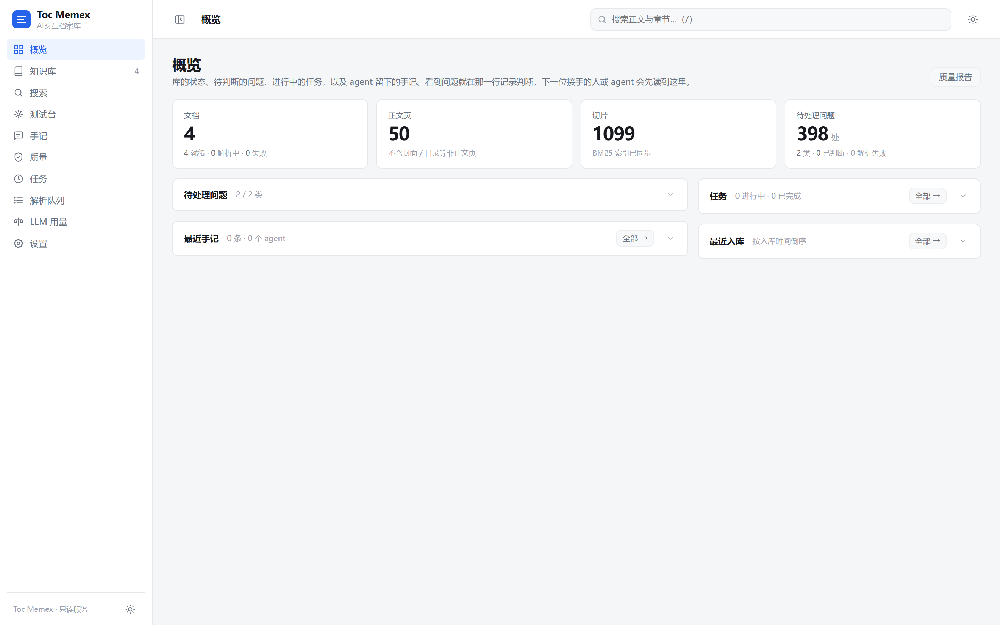

# Toc Memex

**给 agent 的本地文档图书馆：目录由它重建，页码它来对齐，引用钉在原文那一页。**

Toc Memex 在一摞本地 PDF / 扫描件 / Word / Excel 上做三件事：重建目录树、把印刷页码对齐到 PDF 物理页、把检索结果钉在具体页面上。agent 通过 MCP 查库，每条结果都带章节路径和 1-based 页码——它报出的引用和 PDF 阅读器显示的完全一致。

`MIT` · `Python 3.12+` · 本地 SQLite · MCP · 无向量库



## 目录
- [每一步都锚在具体的页上](#每一步都锚在具体的页上)
- [快速开始](#快速开始)
- [给 agent 用](#给-agent-用)
- [界面](#界面)
- [基准](#基准)
- [边界](#边界)
- [许可](#许可)

## 每一步都锚在具体的页上

普通文档 RAG 给结论，Toc Memex 给「结论 + 出处」。整条链路没有一步是模糊的：

- **建目录**：从印刷目录页、PDF 书签、Word 标题、OCR 段落标题还原章节树，把书上印的 `-47-` 对齐到 PDF 的第 53 页；缺失页和重复节点会标出来。
- **检索**：FTS5 BM25 + jieba，支持章节号直达（`8.3`）、文档号直达（`ACME 100`）、目录标题命中置顶、可配同义词表。不做向量检索。
- **记账**：阅读、引用、备注、勘误都绑定到具体页面；文档分区、交接条、agent 会话在同一本账上，别人或别的 agent 接手时先看到这里。

核心是通用规则：章节号、文档号、页码映射；论文、财报、国标只是不同的配置。

## 快速开始

```bash
pipx install git+https://github.com/111aligiant/toc-memex

toc-memex init
toc-memex ingest path/to/documents/     # 一整个文件夹
toc-memex search "8.3" --top 5
toc-memex search "ACME 100" --top 5

toc-memex-web                            # 可选 Web 界面，已预构建，无需 npm
```

不想安装，直接跑 MCP：

```bash
uvx --from git+https://github.com/111aligiant/toc-memex toc-memex-mcp
```

`pip` 卡在无进度（部分 IPv6 网络）时换镜像：`--index-url https://pypi.tuna.tsinghua.edu.cn/simple`。

## 给 agent 用

把 `toc-memex-mcp` 接进 Claude Code / Cursor，默认暴露 8 个工具：
`memex_overview` · `search` · `get_toc` · `read_section` · `add_note` · `mark_used` · `activity_write` · `propose_ops`。

```json
{
  "mcpServers": {
    "toc-memex": {
      "command": "toc-memex-mcp",
      "env": { "TOCMEMEX_DB_PATH": "C:/your/data/tocmemex.db" }
    }
  }
}
```

完整配置见 [`.env.example`](.env.example)。

## 界面

每一屏都对应上面的一步，操作即所见：

| 入库与文档管理 | 目录树与页码对齐 |
|---|---|
|  |  |

| 跨文档检索 | 正文、切片与复核 |
|---|---|
|  |  |

## 基准

5 篇文档、16 道人工标注问题的检索 benchmark，确定性、不依赖 LLM：

| 指标 | 值 |
|---|---|
| citation_page_rate（引用的页 = 证据所在页） | **100.00%** |
| citation_leak_rate（引用串出区间） | **0.00%** |
| hit@k | 68.75% |
| page@1 | 50.00% |

单一语言下数字如上；**跨语言**（中文 query 命中英文文档）通过查询侧双语词表
（`TOCMEMEX_SEARCH_SYNONYMS`，如 `{"氮化物":["nitride"]}`）解锁——16 题主集
hit@k 提升到 87.50%（across 零回归），4 题跨语言专测从 0% 到 75%。词表是
手术刀：只映射对目标语言独有的词，别给中文目标 query 里的词配英文（会把英文
整篇文档拉上来）。样本量只有 16 题，数字可复现但不作排行榜；方法、失败案例与
复现步骤见 [`benchmarks/papers/README.md`](benchmarks/papers/README.md)。

## 边界

- 无向量检索：同义换词会漏；跨语言靠查询侧双语词表（`TOCMEMEX_SEARCH_SYNONYMS`）在配置层面解锁，默认不预设领域词。
- OCR 默认走云端 PaddleOCR-VL（本地 / 私有 provider 可用）；`TOCMEMEX_OCR_ALLOW_PRIVATE_HOSTS=1` 放开内网端点。
- DOCX/DOC 直读走 Word COM，仅 Windows；没有 Word 就先把文档转 PDF。
- 服务无登录，默认只绑 `127.0.0.1`；对外暴露前看 `TOCMEMEX_ALLOW_NONLOCAL` 的说明。
- 数据都在本地：SQLite（`data/tocmemex.db`）+ 数据目录；`scripts/backup.py` 可事务性备份两者。

## 许可

MIT License，见 [`LICENSE`](LICENSE)。第三方代码保留自身许可——`vendor/pageindex/` 为 MIT（Vectify AI），不重新授权。