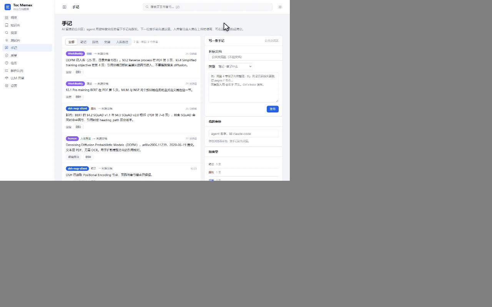
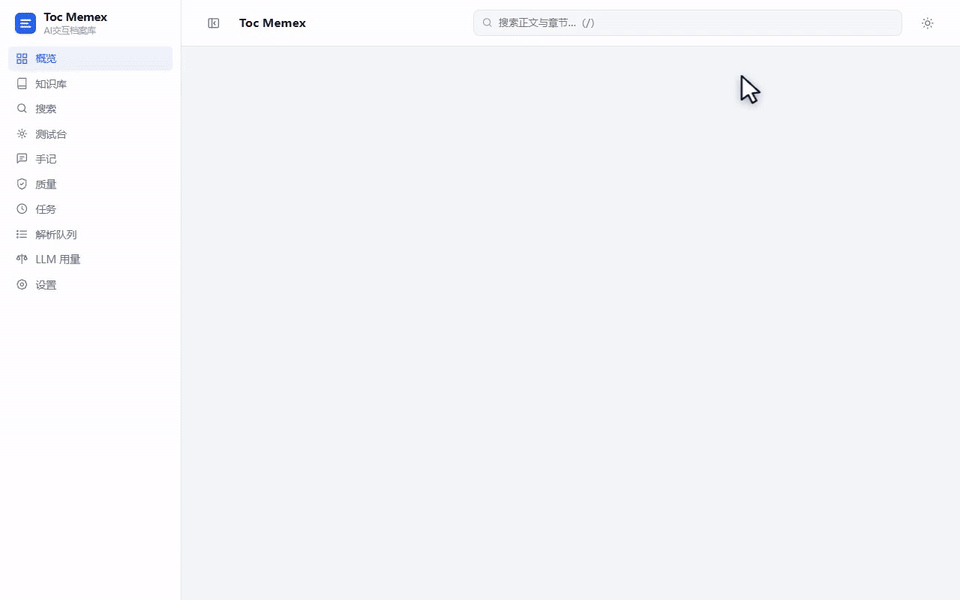
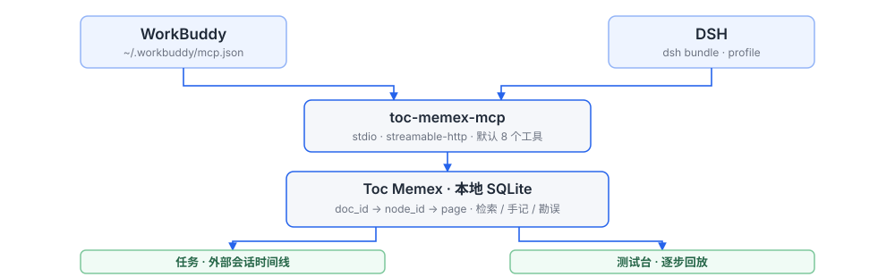
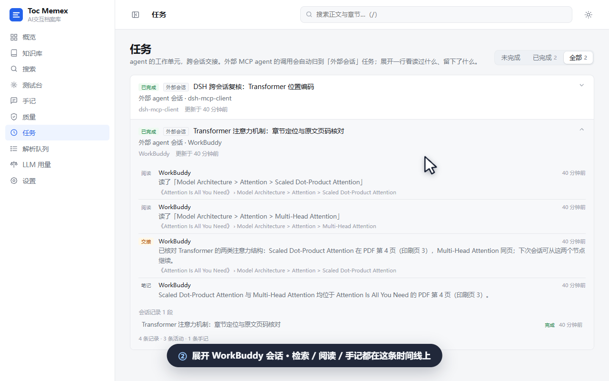
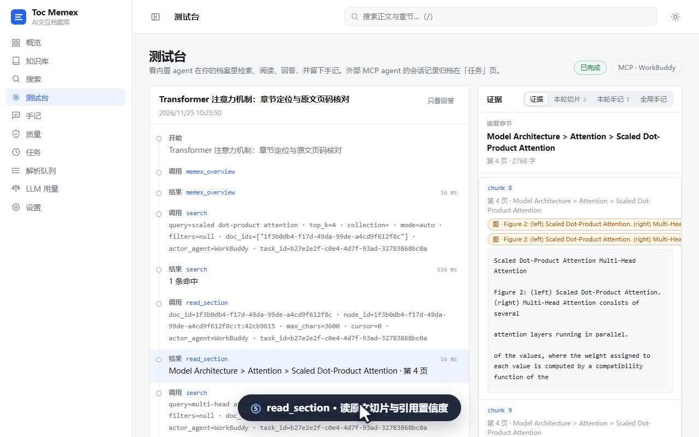
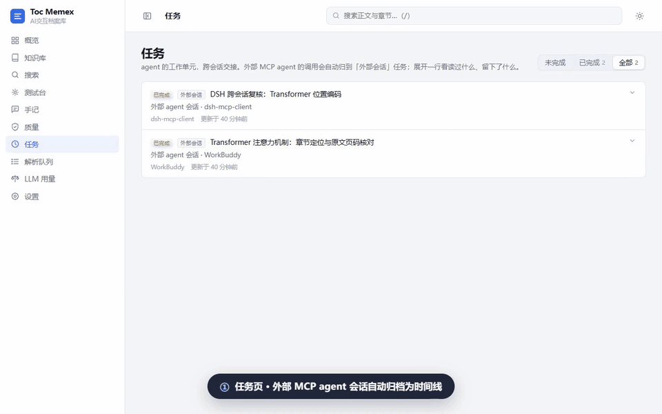
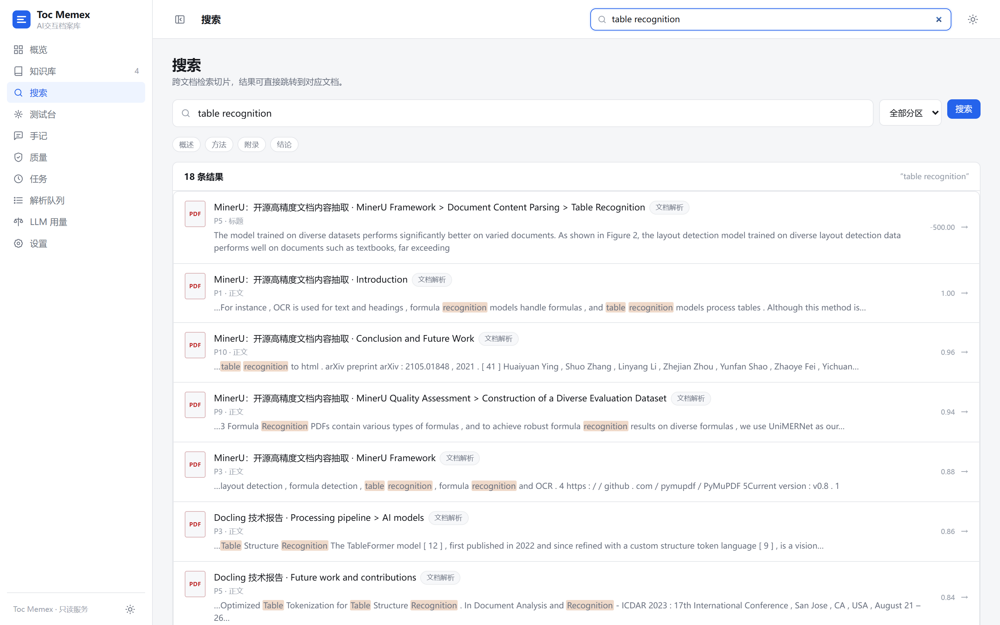

<p align="center">
  
</p>

<h1 align="center">Toc Memex</h1>

<p align="center">
  <a href="LICENSE"></a>
  <a href="pyproject.toml"></a>
  
  
</p>

Toc Memex 把本地 PDF、扫描件、Word 与 Markdown 编成一个可核对的馆藏：目录还原到小节，印刷页码对齐到 PDF 物理页，检索结果、引用、批注与勘误都落在同一个地址上（`doc_id → node_id → page`）。用于交付物需要原文与页码的场景：标准、法规、合同、专利、检测报告、审计底稿。索引与记录留在本地 SQLite，原始文件与 OCR 产物留在数据目录。


---

## 馆藏结构与检索

文档入库后，章节树从 PDF 书签、印刷目录页、Word 标题样式或 OCR 段落标题重建，印刷页码映射到 1-based 的 PDF 物理页。检索与阅读接口统一返回 `doc_id`、`node_id`、`heading_path`、`pdf_page_start` / `pdf_page_end`。`read_section` 另给出 `citation_confidence`（`high` / `page` / `low`），按页码兜底时附带 `citation_note`；返回里包含该节已确认的勘误，以及挂到覆盖切片上的图 / 表资源。缺页、重复标题、短切片、页眉页脚混入、标题与声明页不符等结构问题在入库与巡检时记入质量信号。

检索走 SQLite FTS5 BM25 + jieba，打分之前有确定性路由：章节号（`8.3`）、文档号（`ACME 100`）、分区过滤、查询中逐字出现的目录标题。没有 embedding、reranker 或 LLM 查询改写；请求 `semantic` / `hybrid` 时按词法检索执行，并在返回里置 `degraded=true` 与 `mode_note`。同义词和跨语言词表由 `TOCMEMEX_SEARCH_SYNONYMS` 配置，默认不启用。

## 派生层的治理闭环

| 层 | 内容 | 写入规则 |
|---|---|---|
| 原文层 | PDF / 图片 / Word 文件 | 永不修改 |
| 派生层 | OCR 文本、TOC 节点与页码、切片边界与内容、元数据 | 经提案修改，带快照与回滚 |
| 记录层 | 阅读、引用、批注、勘误、校勘记、交接 | 只追加，修正以新记录追加 |

治理动作只作用于派生层。修正通过 `propose_ops` 提交：`correct_text`、`merge_chunks`、`split_chunk`、`drop_chunk` 等低风险操作可自动落地，`set_page`、`merge_nodes`、`split_node` 列为高风险、等待人工批准。每次应用前写快照，复测变差自动回滚（`auto_rollback`），之后仍可按提案 `undo`。`list_quality_signals` 提供只读的跨文档快照，把零命中查询、被反复检索却从未 `mark_used` 的文档、待批提案、近期自动回滚与勘误计数汇总在一处；编修 agent、MCP 与 `python -m app.curator signals` 拿到同一份 JSON。

## 挂在源位置上的记录

`activity`、`agent_notes`、`errata`、`usage_log`、`tasks` 以 `doc_id / node_id / page` 为锚点，不绑定会话。勘误生命周期是 `proposed → confirmed / rejected`，确认需要第二个 agent 独立复核，修正不覆盖旧记录而是追加新行。`task_timeline` 把同一任务的读写、批注与勘误合成一条时间线；`add_note` 与 `activity_write` 写入的交接和勘误会出现在下一次会话的检索与阅读结果里。未经 `confirmed` 的勘误不进入检索返回，`used / unused` 由 `mark_used` 单独记录。

手记页是记录层的公共入口：按类型分组（笔记 / 踩坑 / 交接 / 入库备注），回复嵌套在原手记下方，刷新与下一次会话都能读到。



[查看 MP4 高清版](assets/notes-flow.mp4)。同样为 0.8× 放映、110% 页面缩放，底部字幕逐步讲解。

## 快速开始

安装后提供三个入口：`toc-memex`（CLI）、`toc-memex-mcp`（MCP）、`toc-memex-web`（Web，前端产物随包分发）。

```bash
pipx install git+https://github.com/111aligiant/toc-memex

toc-memex init                                   # 建库
toc-memex ingest path/to/document.pdf           # 入库一篇文档
toc-memex search "8.3" --top 5                  # 章节号直达，返回带页码
toc-memex-web                                    # 启动 Web 界面
```

不安装也可以直接启动 MCP server：

```bash
uvx --from git+https://github.com/111aligiant/toc-memex toc-memex-mcp
```

`pip` 卡在无进度（部分 IPv6 网络）时换镜像：`--index-url https://pypi.tuna.tsinghua.edu.cn/simple`。

### 入库演示

Web 端上传同样可用：选文件、填入库备注，解析队列分阶段推进（抽取 → 目录重建 → 切片 → 索引），完成后文档带着页数与覆盖率出现在知识库。文本层 PDF 全程不调外部 API，扫描件才需要 OCR Key。



[查看 MP4 高清版](assets/ingest-flow.mp4)。演示上传的是公开论文 DDPM（arXiv:2006.11239）；解析队列等待段以 6× 快进，整体 0.8× 放映、110% 页面缩放，底部字幕逐步讲解。

## 外部 agent 接入

Toc Memex 不替 agent 做判断，只提供带地址的工具面。外部 agent 经 MCP 连入后，握手时自报的 `client_info.name` 记为作者，服务端为连接分配 `session_id`，每次调用落一条 `tool_call` / `tool_result`。对一次调用一条连接的客户端（DSH、WorkBuddy 常见），同一客户端 30 分钟内的调用归并为一个「外部 agent 会话」任务，调用不会散成断线记录；`run_start` / `run_end` 可显式划界。



### WorkBuddy

`~/.workbuddy/mcp.json`：

```json
{
  "mcpServers": {
    "toc-memex": {
      "command": "toc-memex-mcp",
      "env": { "TOCMEMEX_DB_PATH": "C:/your/data/tocmemex.db" }
    }
  }
}
```

默认 `stdio`；客户端只支持 HTTP 时改用 `--transport streamable-http`（端口 8790）。默认工具面 8 个：`memex_overview` · `search` · `get_toc` · `read_section` · `add_note` · `mark_used` · `activity_write` · `propose_ops`；`TOCMEMEX_TOOLS=full` 展开治理、档案与页面级工具。其余配置见 [`.env.example`](.env.example)。

### DSH

在 profile 中插入一条 MCP server（`cordis.patch.yml`），同样以 stdio 直连本地 SQLite：

```yaml
- insert:
    - id: mcp-toc-memex
      name: '@deepseek-ai/dsh-mcp-client'
      config:
        serverName: toc-memex
        transport: stdio
        command: '<repo>/.venv/Scripts/python.exe'
        args: ['-m', 'app.mcp_server']
        cwd: '<repo>'
        env:
          TOCMEMEX_DB_PATH: '<repo>/data/tocmemex.db'
          TOCMEMEX_DATA_DIR: '<repo>/data'
```

`<repo>` 换成仓库绝对路径。多个客户端各起一个进程、连同一个数据库文件，读写记录都落在同一处。

### 一次典型调用

以公开论文 [Attention Is All You Need](https://arxiv.org/abs/1706.03762) 为例，WorkBuddy 与 DSH 可以共用同一份本地馆藏，各自留下可回放的调用与手记：

```text
WorkBuddy
  memex_overview                       → 馆藏与文档计数
  search("scaled dot-product attention")
                                      → 章节路径、node_id、PDF 第 4 页
  read_section(doc_id, node_id)       → 原文切片与 citation_confidence
  mark_used(chunk_id)                 → 标记实际采用的证据
  add_note(kind="handoff")            → 给下一次会话留下交接

DSH
  search("positional encoding")        → 定位同名论文章节
  read_section(doc_id, node_id)       → 读取位置编码原文
  add_note(kind="note")               → 手记挂到 doc_id / node_id / page
```

上面 WorkBuddy 读到的 `Scaled Dot-Product Attention` 对应 PDF 物理页 4、论文印刷页 3。下一次会话仍可按同一节点继续阅读；任务页把两个客户端的调用、阅读和手记分别聚成时间线。

### 动态可视化

Web 的「任务」页把外部会话展开成活动时间线（读过哪一节、留下了什么），「测试台」页按 700ms 轮询回放每一步：调用参数、命中章节、引用与手记。两处都读持久化的 `AgentRun` / `AgentStep`，刷新后仍可回放；外部会话归档在任务页，不出现在测试台历史里。

| 任务 · 外部会话时间线 | 测试台 · 步骤回放 |
|---|---|
|  |  |



[查看 MP4 高清版](assets/agent-session.mp4)。动图为 20 fps、110% 页面缩放，保留鼠标移动与点击反馈，底部字幕逐步讲解：任务页展开会话时间线 → 回放 `search` 与 `read_section` → 核对章节与页码 → `add_note` 留下手记。

演示库只含公开论文 [Attention Is All You Need](https://arxiv.org/abs/1706.03762)、[BERT](https://arxiv.org/abs/1810.04805) 与 [DDPM](https://arxiv.org/abs/2006.11239)，不包含私人馆藏。画面中的 WorkBuddy 与 DSH 记录由 [`scripts/demo_ai_agents.py`](scripts/demo_ai_agents.py) 经 MCP 实际调用生成；入库与手记两条演示的录制见 [`scripts/shoot_flows.py`](scripts/shoot_flows.py)，手记内容由 [`scripts/demo_notes.py`](scripts/demo_notes.py) 写入（页码取自演示库目录）。

## Web 界面

| 知识库列表 | 目录树与页码 |
|---|---|
|  |  |

| 跨文档检索 | 正文与切片复核 |
|---|---|
|  |  |

## 实现与规模

- Python 3.12 / 3.13；SQLAlchemy + aiosqlite + SQLite FTS5；FastAPI；pypdfium2 / pdfplumber 读 PDF；jieba 分词；前端为预构建静态产物。
- `app/` 约 3.26 万行、`tests/` 约 2.28 万行，79 个测试文件。本地全量 `pytest -q`（2026-11-25）：`898 passed, 1 skipped`。
- 文本层文档的抽取、建目录与检索不调用外部 API，也没有按查询计费；扫描件 OCR 与治理裁决用的 LLM 为可选外部调用。
- 索引与记录落在 `data/tocmemex.db` 与数据目录，`scripts/backup.py` 事务性备份两者。

## 适用范围与限制

- 主要适配目录结构完整的规范文档（PDF 书签、印刷目录页或 Word 标题样式）。无目录的散页扫描件与二手资料适配有限。
- Excel / CSV / TSV 在 CLI 与 Web 的分发点拒绝入库。
- 词法检索对同义换词召回弱；跨语言检索依赖 `TOCMEMEX_SEARCH_SYNONYMS` 配置，默认不启用。
- OCR 默认走云端 PaddleOCR-VL，可换本地或私有 provider，`TOCMEMEX_OCR_ALLOW_PRIVATE_HOSTS=1` 放开内网端点。
- DOCX / DOC 直读依赖 Word COM（仅 Windows）；没有 Word 时先转 PDF。
- Web 服务无登录，默认只绑 `127.0.0.1`；对外暴露前看 `TOCMEMEX_ALLOW_NONLOCAL` 的说明。
- 单机 SQLite，未做多租户、权限与团队协作。

## 致谢

站在这些开源工具的肩膀上：

- **OCR** —— [PaddleOCR-VL](https://github.com/PaddlePaddle/PaddleOCR) 提供结构化输出（`parsing_res_list` 的 label / bbox / order），是目录重建与页码对齐的原始依据。
- **LLM 接入** —— [magpie](https://github.com/yetone/magpie) 本地模型网关提供低成本模型调用，Toc Memex 用 `/api/endpoints/magpie/probe` 探测本机默认端口。
- **目录结构处理** —— [PageIndex](https://github.com/VectifyAI/PageIndex)（MIT）。书签/目录解析的逻辑借鉴它，见 [`vendor/pageindex/`](vendor/pageindex/NOTICE.md)。
- **离线 PDF 引擎** —— [pypdfium2](https://github.com/pypdfium2-team/pypdfium2)（PDFium 绑定）读 PDF 书签、提文本、渲染；[pdfplumber](https://github.com/jsvine/pdfplumber) 提供表格与版面矩形。

## 贡献

欢迎提交 issue 与 PR。目录重建失败的报告请尽量附上真实文档（可公开或脱敏可复现）；也接受 bug 修复、测试补充与 provider 适配。

测试在 `tests/`：`pip install -e ".[dev]" && python -m pytest -q`。

## 许可

MIT License，见 [`LICENSE`](LICENSE)。第三方代码保留自身许可——`vendor/pageindex/` 为 MIT（Vectify AI），不重新授权。
